# orchestrator

A movie-inventory and billing platform split into six containers. They run on a two-node K3s cluster
built by Vagrant, from images on Docker Hub, and one script drives all of it:
`./orchestrator.sh create | start | stop`.

<p align="center">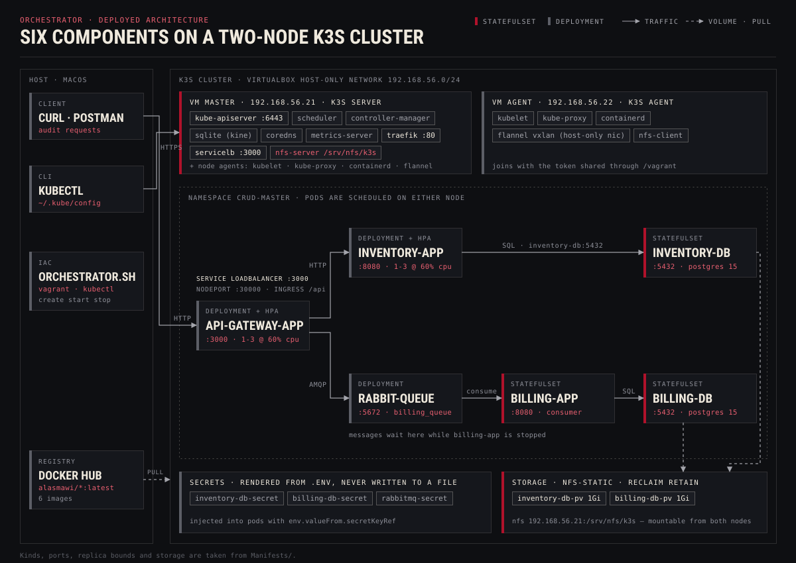</p>

<sub>The diagram is animated. Blue packets are a synchronous movies request: client → LoadBalancer
→ api-gateway-app → inventory-app → inventory-db. Orange packets are a billing message: client →
gateway → rabbit-queue → billing-app → billing-db. Green is kubectl talking to the API server. With
reduced motion enabled, the diagram is static.</sub>

**Contents**
[Components](#components) ·
[Quick start](#quick-start) ·
[Configuration](#configuration) ·
[Usage](#usage) ·
[Proof of state](#proof-of-state) ·
[How it meets the spec](#how-it-meets-the-spec) ·
[Audit runbook](#audit-runbook) ·
[Concepts](#concepts) ·
[Troubleshooting](#troubleshooting)

---

## Components

| Component | Does | Kind | Port | Scaling | Storage | Image |
|---|---|---|---|---|---|---|
| **api-gateway-app** | Entry point. Proxies `/api/movies` to inventory-app, publishes `/api/billing` to RabbitMQ | `Deployment` + `HPA` | `3000` | 1 → 3 at 60% CPU | | `alasmawi/api-gateway-app` |
| **inventory-app** | Movies CRUD API (Flask + SQLAlchemy) | `Deployment` + `HPA` | `8080` | 1 → 3 at 60% CPU | | `alasmawi/inventory-app` |
| **billing-app** | Consumes `billing_queue`, writes orders to billing-db | `StatefulSet` | `8080` | 1 | | `alasmawi/billing-app` |
| **rabbit-queue** | RabbitMQ broker holding `billing_queue` | `Deployment` | `5672` (UI `15672`) | 1 | | `alasmawi/rabbit-queue` |
| **inventory-db** | PostgreSQL 15, database `movies_db`, table `movies` | `StatefulSet` | `5432` | 1 | 1 Gi NFS PV | `alasmawi/inventory-db` |
| **billing-db** | PostgreSQL 15, database `billing_db`, table `orders` | `StatefulSet` | `5432` | 1 | 1 Gi NFS PV | `alasmawi/billing-db` |

Every image is built from [`Dockerfiles/`](Dockerfiles), which holds my own `play-with-containers`
solution (Debian base images, non-root apps), and is pushed to my Docker Hub account. The cluster
doesn't use any third-party application images.

### Request flows

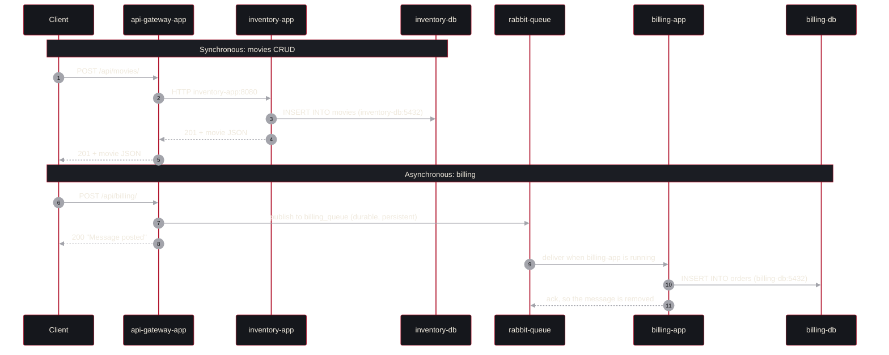

The billing call answers `200` as soon as RabbitMQ has the message. While billing-app is stopped,
messages stay in `billing_queue`, and they're written to billing-db once billing-app is back. The
audit checks exactly this, with `user_id` 22.

### Networking

| From | To | Through |
|---|---|---|
| Host | `192.168.56.21:6443` (API server) | `~/.kube/config` → `.kube/config`, default namespace `crud-master` |
| Host | `http://192.168.56.21:3000` | Service `type: LoadBalancer`, implemented by K3s ServiceLB on every node |
| Host | `http://192.168.56.2{1,2}:30000` | the NodePort of the same Service |
| Host | `http://192.168.56.21/api/...` | Traefik `Ingress` |
| Pod | `inventory-app:8080`, `rabbit-queue:5672`, `*-db:5432` | ClusterIP and headless Services, resolved by CoreDNS |
| Node | Node | flannel VXLAN, pinned to the host-only NIC with `--flannel-iface` |

## Project structure

```
.
├── orchestrator.sh              # create | start | stop | deploy | status | destroy
├── Vagrantfile                  # master + agent VMs (bento/ubuntu-22.04, amd64 and arm64)
├── .env.example                 # every credential and setting, as a template
├── Manifests/                   # one YAML per component or resource
│   ├── namespace.yaml           #   crud-master
│   ├── storage.yaml             #   StorageClass nfs-static + 2 NFS PersistentVolumes
│   ├── inventory-db.yaml        #   headless Service + StatefulSet + volumeClaimTemplate
│   ├── billing-db.yaml          #   headless Service + StatefulSet + volumeClaimTemplate
│   ├── rabbit-queue.yaml        #   Deployment + Service
│   ├── inventory-app.yaml       #   Deployment + ClusterIP Service
│   ├── inventory-app-hpa.yaml   #   HPA 1..3 at 60% CPU
│   ├── billing-app.yaml         #   headless Service + StatefulSet
│   ├── api-gateway-app.yaml     #   Deployment + LoadBalancer Service + Ingress
│   └── api-gateway-app-hpa.yaml #   HPA 1..3 at 60% CPU
├── Scripts/
│   ├── k3s-master.sh            # NFS server + K3s server; shares kubeconfig and join token
│   ├── k3s-agent.sh             # NFS client + K3s agent; joins the master
│   ├── apply-secrets.sh         # .env → 3 Secrets, piped to the API server
│   ├── build-push.sh            # build the 6 images and push them to Docker Hub
│   └── audit-check.sh           # runs the audit's hands-on steps, prints PASS/FAIL
├── Dockerfiles/                 # one directory per image: Dockerfile + source
│   ├── inventory-db/  billing-db/  rabbit-queue/
│   └── inventory-app/ billing-app/ api-gateway-app/
└── docs/                        # README diagrams, screenshots and their generators
```

The layout follows the subject's tree. There are two additions. `orchestrator.sh` sits at the root so
it runs exactly as the subject shows it (`./orchestrator.sh create`), and `docs/` holds this
README's images.

## Prerequisites

| Tool | Tested with | Why |
|---|---|---|
| [VirtualBox](https://www.virtualbox.org/) | 7.2 | hypervisor for the two VMs (Apple Silicon needs 7.1 or later) |
| [Vagrant](https://developer.hashicorp.com/vagrant/install) | 2.4 | creates and provisions the VMs |
| [kubectl](https://kubernetes.io/docs/tasks/tools/) | 1.37 | manages the cluster from the host (`brew install kubectl`) |
| [Docker](https://docs.docker.com/get-docker/) | 29 | builds and pushes the images |
| A [Docker Hub](https://hub.docker.com/) account | | the registry the cluster pulls from |

The two VMs take 2 vCPU and 2 GB RAM each, so keep about **4 GB** free. They also need internet
access to download K3s and the images.

## Quick start

```bash
cp .env.example .env          # 1. set passwords and DOCKERHUB_USERNAME
docker login                  # 2. sign in to Docker Hub
./Scripts/build-push.sh       # 3. build and push the 6 images
./orchestrator.sh create      # 4. VMs + K3s + every workload, about 5-10 minutes
kubectl get nodes -A          # 5. both nodes Ready
./Scripts/audit-check.sh      # 6. optional: rehearse the audit
```

`create` does the following:

1. Boots `master`. It installs the NFS server and the K3s server, then writes the kubeconfig and
   the join token to `.kube/` through the shared folder.
2. Boots `agent`. It installs the NFS client and joins the cluster.
3. Points the kubeconfig's default namespace at `crud-master` and links `~/.kube/config` to it, so
   plain `kubectl` commands work. An existing `~/.kube/config` is never overwritten.
4. Applies namespace → storage → secrets → databases → queue → apps → HPAs.
5. Waits until every workload is ready, then prints `cluster created`.

Images are built for the host's CPU, which is also the VMs' CPU. To publish multi-arch images, run
`PLATFORMS=linux/amd64,linux/arm64 ./Scripts/build-push.sh` (needs `docker buildx`).

## Configuration

All configuration lives in `.env`, which is gitignored. [`.env.example`](.env.example) is the
template.

| Variable | Feeds | Example |
|---|---|---|
| `INVENTORY_DB_NAME` / `_USER` / `_PASSWORD` | `inventory-db-secret` → inventory-db, inventory-app | `movies_db` / `inventory_user` / … |
| `BILLING_DB_NAME` / `_USER` / `_PASSWORD` | `billing-db-secret` → billing-db, billing-app | `billing_db` / `billing_user` / … |
| `RABBITMQ_USER` / `_PASSWORD` | `rabbitmq-secret` → rabbit-queue, billing-app, api-gateway-app | `billing_mq` / … |
| `DOCKERHUB_USERNAME` | `__DOCKERHUB_USERNAME__` in the workload manifests | `alasmawi` |
| `IMAGE_TAG` | `__IMAGE_TAG__` in the workload manifests | `latest` |

The node IPs (`192.168.56.21` and `.22`) and the VM sizes are set in the [`Vagrantfile`](Vagrantfile).

### Secrets

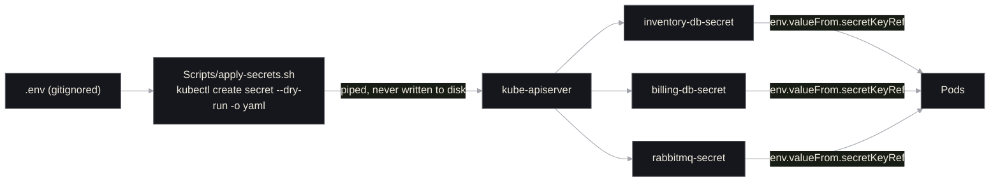

The subject allows credentials only in Secret manifests. This project goes further: the Secret
manifests are generated in memory and piped straight to the API server, so **no committed file
contains a credential**. Every workload reads its credentials through `secretKeyRef`:

```bash
kubectl get secrets -o json                                         # what the audit runs
kubectl get secret billing-db-secret -o jsonpath='{.data.POSTGRES_DB}' | base64 -d
```

## Usage

### `orchestrator.sh`

| Command | Does | Prints |
|---|---|---|
| `create` | `vagrant up`, configures kubectl, deploys everything and waits for it | `cluster created` |
| `start` | boots halted VMs; K3s and every workload come back by themselves | `cluster started` |
| `stop` | `vagrant halt`; VMs, volumes and data are kept | `cluster stopped` |
| `deploy` | re-applies secrets and manifests on a running cluster | `workloads deployed` |
| `status` | nodes, workloads, HPAs, Services, Ingress and PVCs | |
| `destroy` | deletes both VMs (including the NFS data) and `.kube/` | `cluster destroyed` |

### API

```bash
GW=http://192.168.56.21:3000      # also :30000 on either node, or http://192.168.56.21/api via Ingress

curl -X POST $GW/api/movies/ -H 'Content-Type: application/json' \
     -d '{"title": "A new movie", "description": "Very short description"}'   # 201
curl $GW/api/movies/                                                          # 200
curl "$GW/api/movies/?title=new"
curl -X PUT $GW/api/movies/1 -H 'Content-Type: application/json' -d '{"description": "Updated"}'
curl -X DELETE $GW/api/movies/1
curl -X POST $GW/api/billing/ -H 'Content-Type: application/json' \
     -d '{"user_id": "20", "number_of_items": "99", "total_amount": "250"}'   # 200
```

| Method | Path | Returns |
|---|---|---|
| `GET` | `/api/movies[?title=…]` | `200`: every movie, or those whose title contains the filter |
| `POST` | `/api/movies` | `201`: the created movie |
| `DELETE` | `/api/movies` | `200`: all movies deleted |
| `GET` · `PUT` · `DELETE` | `/api/movies/{id}` | `200`, or `404` if the id doesn't exist |
| `POST` | `/api/billing` | `200` `{"message":"Message posted"}` |
| `GET` | `/health` | `200`: liveness of the gateway |

Paths work with or without a trailing slash, like the audit's `.../api/movies/`. For the RabbitMQ
UI, run `kubectl port-forward svc/rabbit-queue 15672:15672` and open http://localhost:15672.

## Proof of state

These are rendered from real output on a cluster built with a clean `./orchestrator.sh create`,
captured by `CAPTURE_DIR=docs/screens/raw ./Scripts/audit-check.sh`. The raw text is in
[`docs/screens/raw/`](docs/screens/raw). The `create` and `stop`/`start` captures keep only the
step and result lines; nothing else is shortened or edited. The auditor checks the live cluster
anyway, so no video recording is needed.

<details open>
<summary><b>orchestrator.sh: create, stop, start</b></summary>

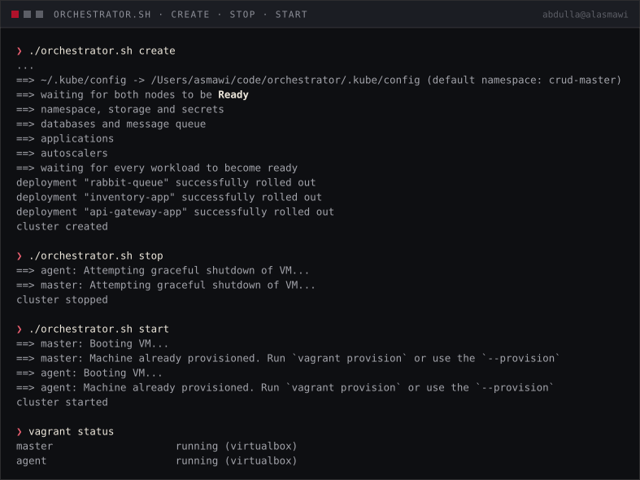
</details>

<details open>
<summary><b>Nodes: master and agent connected and Ready</b></summary>

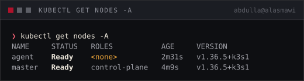
</details>

<details>
<summary><b>Every deployed resource</b></summary>

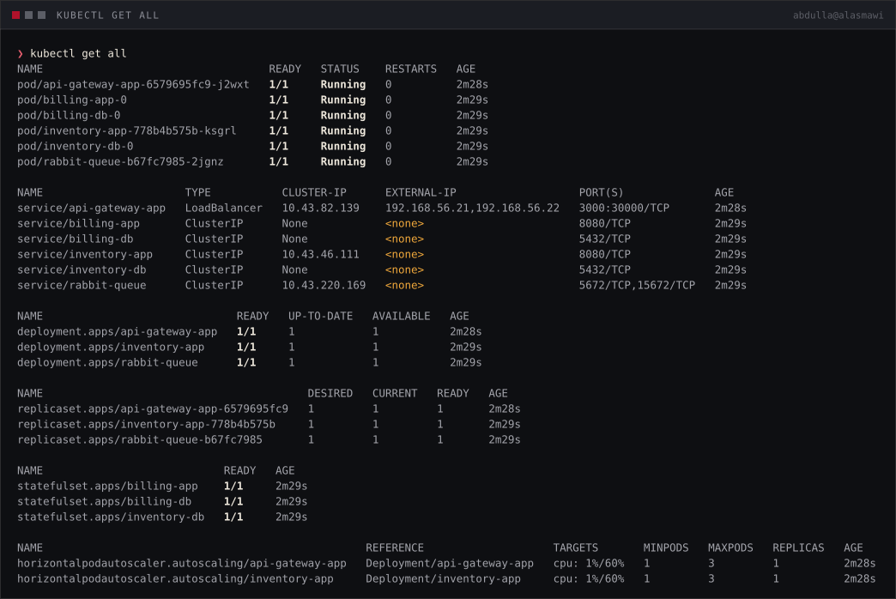
</details>

<details>
<summary><b>Autoscalers and volumes</b></summary>

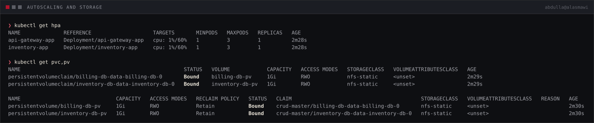
</details>

<details>
<summary><b>Images from Docker Hub and the three Secrets</b></summary>

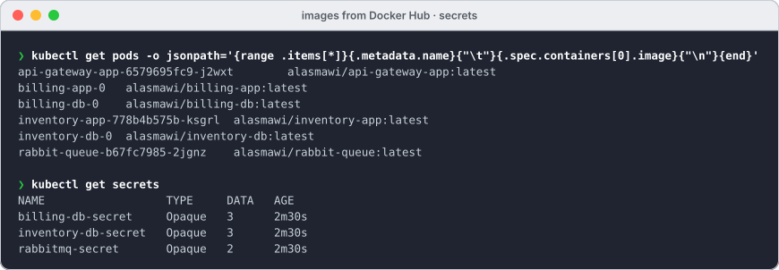
</details>

<details>
<summary><b>Inventory API: 201 then 200</b></summary>

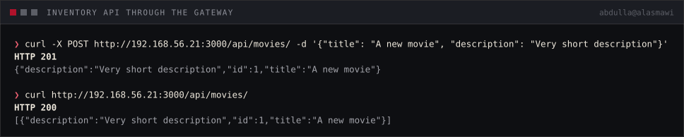
</details>

<details>
<summary><b>Queue resilience: user_id 22 waits while billing-app is stopped</b></summary>

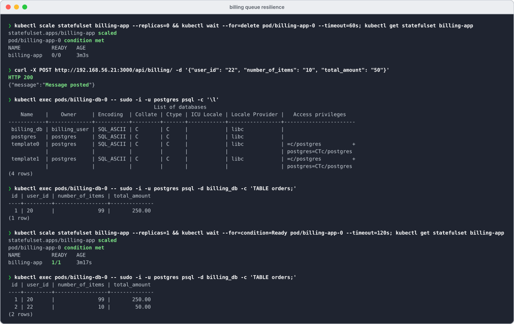
</details>

<details open>
<summary><b>The whole audit, automated</b></summary>

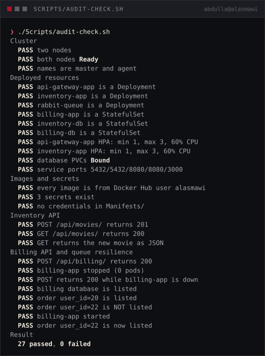
</details>

## How it meets the spec

| Requirement | Where | How |
|---|---|---|
| K3s in Vagrant, 2 VMs: Master, Agent | [`Vagrantfile`](Vagrantfile), [`Scripts/k3s-*.sh`](Scripts) | `master` is the K3s server and `agent` joins it with the shared token |
| `kubectl` on the host | `orchestrator.sh` `configure_kubectl` | the kubeconfig is linked to `~/.kube/config` with namespace `crud-master` |
| `orchestrator.sh` create / start / stop | [`orchestrator.sh`](orchestrator.sh) | prints `cluster created` / `cluster started` / `cluster stopped` |
| Images on Docker Hub, used in the manifests | [`Scripts/build-push.sh`](Scripts/build-push.sh) | all 6 images are `alasmawi/<component>:latest` |
| One manifest per component | [`Manifests/`](Manifests) | 10 files, listed in [Project structure](#project-structure) |
| Credentials only in Secrets | [`Scripts/apply-secrets.sh`](Scripts/apply-secrets.sh) | 3 Secrets, `secretKeyRef` everywhere, no credential in any file |
| api-gateway and inventory-app: Deployment + HPA 1-3 @ 60% | `*-app.yaml`, `*-hpa.yaml` | `autoscaling/v2`, CPU requests `100m` |
| billing-app: StatefulSet | [`billing-app.yaml`](Manifests/billing-app.yaml) | headless Service, stable pod `billing-app-0` |
| Databases: StatefulSet + volumes that move | `*-db.yaml`, [`storage.yaml`](Manifests/storage.yaml) | `volumeClaimTemplates` bound to NFS PVs that both nodes can mount |
| Ports 5432 · 5432 · 8080 · 8080 · 3000 | Services in each manifest | checked by `audit-check.sh` |
| README | this file | prerequisites, configuration, setup, usage, proof, concepts |
| **Bonus**: own `play-with-containers` Dockerfiles | [`Dockerfiles/`](Dockerfiles) | all six images, databases and RabbitMQ included |
| **Bonus**: Ingress, LoadBalancer, audit automation | `api-gateway-app.yaml`, `audit-check.sh` | Traefik `/api`, ServiceLB `:3000`, automated PASS/FAIL checks |

<details>
<summary><b>Why the databases can move between nodes without losing data</b></summary>

K3s' default `local-path` storage writes to the disk of the node that created the volume, which pins
a database pod to that node for good. Here, each database's `volumeClaimTemplate` selects a
`PersistentVolume` in the `nfs-static` StorageClass (`reclaimPolicy: Retain`). That PV is a
directory exported over NFS by the master VM, so whichever node the pod lands on mounts the same
data.

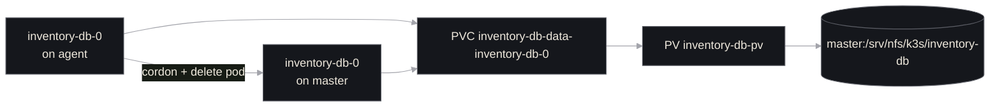

```bash
NODE=$(kubectl get pod inventory-db-0 -o jsonpath='{.spec.nodeName}')
kubectl cordon "$NODE" && kubectl delete pod inventory-db-0
kubectl get pod inventory-db-0 -o wide        # now on the other node
curl http://192.168.56.21:3000/api/movies/    # same movies
kubectl uncordon "$NODE"
```
</details>

<details>
<summary><b>Watching the HPA scale</b></summary>

```bash
kubectl get hpa -w
# in a second terminal:
kubectl run load --rm -it --image=busybox:1.36 --restart=Never -- \
  sh -c 'while true; do wget -qO- http://api-gateway-app:3000/api/movies >/dev/null; done'
```

Measured during testing: gateway CPU rose from `1%` to `299%/60%` and the gateway scaled to 3 pods,
with inventory-app at 2. Utilization is CPU usage ÷ the `100m` request. When the load stops, the
HPA waits out its 5-minute stabilization window, then scales back to 1.
</details>

<details>
<summary><b>Other verified behaviour</b></summary>

| Check | Result |
|---|---|
| Pods spread across both nodes talk to each other | ✅ flannel on the host-only NIC (VirtualBox gives every VM the same NAT IP) |
| Database pod cordoned off its node and deleted | ✅ rescheduled on the other node, data intact, no failed request |
| `stop` then `start` | ✅ every pod comes back by itself, data intact |
| billing-db down while orders are posted | ✅ messages wait in the queue and are stored once the DB is back; billing-app doesn't crash |
| Special characters in DB passwords | ✅ safe thanks to `URL.create` in the apps and psql variables in the DB entrypoint |
</details>

## Audit runbook

The auditor's steps, the commands that answer them, and the expected result.
`./Scripts/audit-check.sh` runs every hands-on step and prints PASS/FAIL. Run it before each audit.

| # | Audit step | Command | Expected |
|---|---|---|---|
| 1 | Clone at the given commit | `git clone … && git reset --hard <sha>` | no `fatal: reference is not a tree` |
| 2 | Required files and structure | `ls` | `Manifests/ Scripts/ Dockerfiles/ Vagrantfile orchestrator.sh README.md` |
| 3 | Images from my Docker Hub | `kubectl get pods -o jsonpath='{..image}'` · [hub.docker.com/u/alasmawi](https://hub.docker.com/u/alasmawi) | only `alasmawi/*` |
| 4 | kubectl installed, 2 nodes Ready | `kubectl get nodes -A` | `master` and `agent`, both `Ready` |
| 5 | Created by Vagrant | `vagrant status` | `master running`, `agent running` |
| 6 | create / start / stop | `./orchestrator.sh create`, `stop`, `start` | `cluster created`, `cluster stopped`, `cluster started` |
| 7 | No credentials in manifests | `grep -rni password Manifests/` | only `secretKeyRef` references |
| 8 | Secrets hold every credential | `kubectl get secrets -o json` | 3 Secrets: DB user, password and name ×2, RabbitMQ user and password |
| 9 | All apps deployed | `kubectl get all` | 3 Deployments, 3 StatefulSets, 6 Services, 2 HPAs |
| 10 | POST `/api/movies/` | Postman → `http://192.168.56.21:3000/api/movies/` | **201** |
| 11 | GET `/api/movies/` | same URL, `GET` | **200**, JSON with the new movie |
| 12 | POST `/api/billing/` user 20 | `http://192.168.56.21:3000/api/billing/` | **200** |
| 13 | Stop billing-app | `kubectl scale statefulset billing-app --replicas=0` | `kubectl get pods`: no `billing-app-0` |
| 14 | POST `/api/billing/` user 22 | same URL | **200** while billing-app is down |
| 15 | Billing database listed | `kubectl exec -it pods/billing-db-0 -- sh` → `sudo -i -u postgres` → `psql` → `\l` | `billing_db` |
| 16 | Orders | `\c billing_db` → `TABLE orders;` | user 20 present, user 22 **absent** |
| 17 | Start billing-app | `kubectl scale statefulset billing-app --replicas=1` | `billing-app-0` `1/1 Running` |
| 18 | Order 22 arrives | `TABLE orders;` again | user 22 now present |

The gateway is reachable at `[GATEWAY_IP]:[GATEWAY_PORT]` = `192.168.56.21:3000`, and also at
`192.168.56.22:3000`, `:30000` on either node, or `http://192.168.56.21/api/...`.

## Concepts

<p align="center"></p>

<details open>
<summary><b>Orchestration, Kubernetes, K3s</b></summary>

- **Container orchestration** automates running containers across many machines: placing them,
  restarting them when they fail, scaling them, networking them and rolling out new versions. The
  benefits are self-healing, horizontal scaling, efficient use of machines, declarative and
  repeatable deployments, and zero-downtime updates.
- **Kubernetes** is the standard orchestrator. You declare the desired state (objects such as
  Deployments, Services and Secrets), and its control loops keep making the actual state match it.
- **K3s** is a lightweight, CNCF-certified Kubernetes distribution packaged as one binary. It swaps
  etcd for SQLite by default and bundles containerd, flannel, CoreDNS, Traefik, ServiceLB,
  metrics-server and local-path storage. That suits VMs, edge devices and labs like this one. Here,
  `master` runs the K3s server and `agent` runs the K3s agent.
</details>

<details>
<summary><b>Infrastructure as code and manifests</b></summary>

- **Infrastructure as code** means describing infrastructure in versioned files instead of building
  it by hand. Here that's the `Vagrantfile` (VMs), the provisioning scripts (K3s and NFS), the
  manifests (workloads) and `orchestrator.sh` (the workflow). The advantages: environments are
  reproducible, every change is reviewable in git, you can rebuild from scratch in one command,
  nothing drifts between machines, and the files double as documentation.
- **A Kubernetes manifest** is a YAML (or JSON) description of one or more objects. It has
  `apiVersion`, `kind`, `metadata` (name, namespace, labels) and `spec`, which is the desired state.
  `kubectl apply` sends it to the API server, and controllers make it real.

| Manifest | Objects | Role |
|---|---|---|
| `namespace.yaml` | Namespace | isolates every project object under `crud-master` |
| `storage.yaml` | StorageClass, 2 PersistentVolumes | NFS-backed storage that both nodes can mount, kept after deletion (`Retain`) |
| `inventory-db.yaml`, `billing-db.yaml` | headless Service, StatefulSet | PostgreSQL with stable identity `*-db-0`, its own PVC, probes on `pg_isready` |
| `rabbit-queue.yaml` | Deployment, Service | RabbitMQ on `5672`, management UI on `15672` |
| `inventory-app.yaml` | Deployment, Service | movies API on `8080`, credentials from `inventory-db-secret` |
| `billing-app.yaml` | headless Service, StatefulSet | queue consumer, `8080` health endpoint |
| `api-gateway-app.yaml` | Deployment, LoadBalancer Service, Ingress | public entry on `3000` / `30000` / `:80/api` |
| `*-hpa.yaml` | HorizontalPodAutoscaler | 1 to 3 replicas, 60% average CPU target |
</details>

<details>
<summary><b>Deployment, StatefulSet, scaling, load balancing</b></summary>

- **Deployment**: manages a ReplicaSet of interchangeable pods with random names. They can be
  created, deleted and replaced in any order, and rolling updates come built in. That fits
  stateless apps such as the gateway and inventory-app.
- **StatefulSet**: manages pods with a stable, ordered identity (`name-0`, `name-1`, …), a stable DNS
  name through a headless Service, and a PVC per pod created from `volumeClaimTemplates`. That PVC
  follows the pod's identity when the pod is rescheduled. Pods are created and deleted in order.
- **The difference**: Deployment pods are disposable and identical. StatefulSet pods are individuals
  that keep their name and their storage.
- **Why a database isn't a Deployment**: replicas of a Deployment share one PVC or get none, have no
  stable identity, and can run two at once during a rolling update. Two PostgreSQL servers writing
  the same data directory corrupt it. A StatefulSet keeps exactly one `billing-db-0` bound to its own
  volume, and starts its replacement only after the old pod is gone.
- **Scaling** means changing capacity to match load. *Horizontal* scaling adds more pods, which the
  HPA does here on CPU. *Vertical* scaling gives each pod more CPU or memory. It keeps latency steady
  under load and saves resources when traffic is quiet.
- **Load balancer**: spreads incoming traffic across healthy backends, so no single instance is
  overloaded and failed ones are skipped. Here, every Service load-balances across its pods
  (kube-proxy), ServiceLB exposes the gateway on every node's `:3000` (`type: LoadBalancer`), and
  Traefik balances HTTP on `:80`.
</details>

## Troubleshooting

<details>
<summary><code>ErrImagePull</code> / <code>ImagePullBackOff</code></summary>

Either the image isn't on Docker Hub under `DOCKERHUB_USERNAME`, or it was built for another CPU
architecture. Check with `kubectl describe pod <pod>`. Then run `./Scripts/build-push.sh` and
`./orchestrator.sh deploy`.
</details>

<details>
<summary><code>kubectl</code> answers "connection refused" or shows no resources</summary>

The cluster is stopped (`./orchestrator.sh start`), or `~/.kube/config` belongs to another cluster.
In that case, run `export KUBECONFIG=$(pwd)/.kube/config`. Resources live in `crud-master`, which is
the default namespace of this kubeconfig.
</details>

<details>
<summary>The agent never becomes Ready</summary>

Check `vagrant ssh agent -c 'sudo journalctl -u k3s-agent -n 50'`. The usual cause is a stale join
token from an older cluster. Run `./orchestrator.sh destroy`, then `./orchestrator.sh create`.
</details>

<details>
<summary>A database PVC stays <code>Pending</code></summary>

Run `kubectl get pv`: both PVs should be `Available` or `Bound`. A PV left `Released` after its
claim was deleted needs its claimRef cleared:
`kubectl patch pv inventory-db-pv -p '{"spec":{"claimRef":null}}'`.
</details>

<details>
<summary>HPA shows <code>&lt;unknown&gt;/60%</code></summary>

metrics-server needs about a minute after start-up before it reports CPU. Check with
`kubectl top pods`.
</details>

## Regenerating the docs images

```bash
python3 docs/tools/diagrams.py                              # architecture + components (icons in docs/icons)
CAPTURE_DIR=docs/screens/raw ./Scripts/audit-check.sh       # capture real output
./docs/tools/render-screens.sh                              # raw text → docs/screens/*.svg
```
