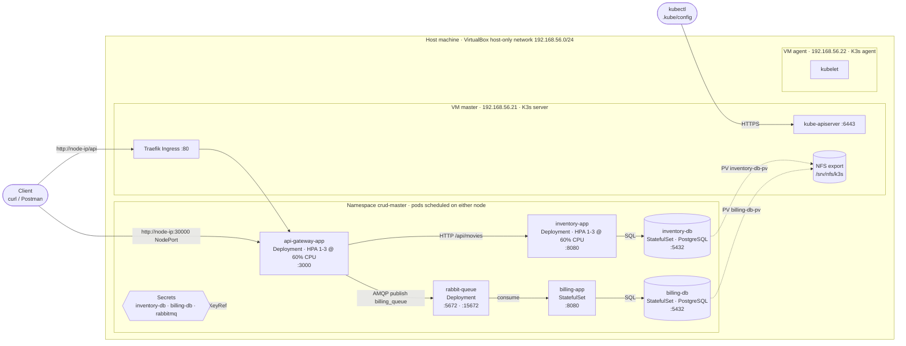
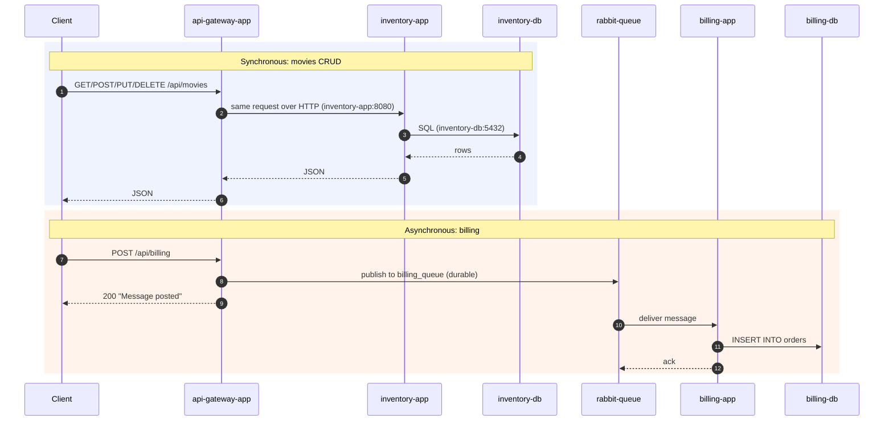
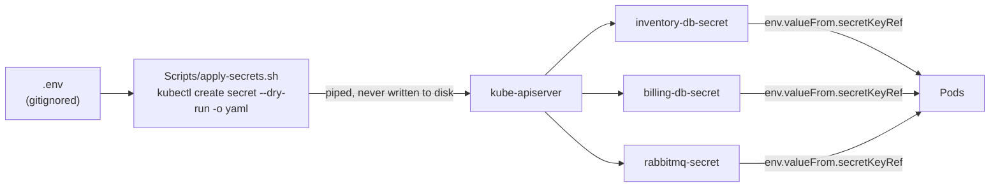
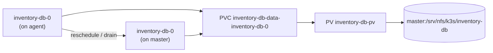

<div align="center">

# orchestrator

**A microservices architecture deployed on a two-node K3s cluster, provisioned with Vagrant and driven by one script.**


[Architecture](#architecture) ·
[Quick start](#quick-start) ·
[Configuration](#configuration) ·
[Usage](#usage) ·
[How it meets the spec](#how-it-meets-the-spec) ·
[Verification](#verification) ·
[Audit cheat sheet](#audit-cheat-sheet) ·
[Troubleshooting](#troubleshooting)

</div>

---

## Overview

Six containers make up a small movie-inventory and billing platform:

| Component | What it does | Kubernetes kind | Port | Scaling | Storage |
|---|---|---|---|---|---|
| **api-gateway-app** | Public entry point. Proxies `/api/movies` to inventory-app and publishes `/api/billing` to RabbitMQ | `Deployment` + `HPA` | `3000` | 1 → 3 pods at 60% CPU | none |
| **inventory-app** | Movies CRUD API (Flask + SQLAlchemy) | `Deployment` + `HPA` | `8080` | 1 → 3 pods at 60% CPU | none |
| **billing-app** | Consumes `billing_queue`, writes orders to billing-db | `StatefulSet` | `8080` | 1 pod | none |
| **rabbit-queue** | RabbitMQ broker holding `billing_queue` | `Deployment` | `5672` (`15672` UI) | 1 pod | none |
| **inventory-db** | PostgreSQL, `movies` table | `StatefulSet` | `5432` | 1 pod | 1 Gi NFS PV |
| **billing-db** | PostgreSQL, `orders` table | `StatefulSet` | `5432` | 1 pod | 1 Gi NFS PV |

All of them run in the `crud-master` namespace. The three application images are built from
[`Dockerfiles/`](Dockerfiles) and pulled from Docker Hub. PostgreSQL and RabbitMQ use their official
images.

## Architecture



### Request flows



Because billing goes through the queue, `POST /api/billing` keeps answering while billing-app is
down. Messages wait in `billing_queue` and are processed once billing-app comes back.

### Networking at a glance

| Who | Reaches | Through |
|---|---|---|
| Host → cluster API | `192.168.56.21:6443` | `.kube/config`, written by the master during provisioning |
| Host → gateway | `http://192.168.56.21/api/...` | Traefik `Ingress` bundled with K3s |
| Host → gateway | `http://192.168.56.2{1,2}:30000/api/...` | `NodePort` Service |
| Pod → pod | `inventory-app:8080`, `rabbit-queue:5672`, `inventory-db:5432`, `billing-db:5432` | ClusterIP / headless Services and CoreDNS |
| Node → node | flannel VXLAN over `192.168.56.0/24` | `--flannel-iface` pinned to the host-only NIC |

## Project structure

```
.
├── orchestrator.sh              # create | start | stop | deploy | status | destroy
├── Vagrantfile                  # master + agent VMs (bento/ubuntu-22.04, amd64 or arm64)
├── .env.example                 # every credential and setting the project needs
├── Scripts/
│   ├── k3s-master.sh            # NFS server + K3s server, publishes kubeconfig and join token
│   ├── k3s-agent.sh             # NFS client + K3s agent, joins the master
│   ├── apply-secrets.sh         # .env → 3 Kubernetes Secrets (never written to disk)
│   └── build-push.sh            # build the 3 app images and push them to Docker Hub
├── Manifests/
│   ├── namespace.yaml           # crud-master namespace
│   ├── storage.yaml             # StorageClass + 2 NFS PersistentVolumes
│   ├── inventory-db.yaml        # headless Service + StatefulSet + volumeClaimTemplate
│   ├── billing-db.yaml          # headless Service + StatefulSet + volumeClaimTemplate
│   ├── rabbit-queue.yaml        # Deployment + Service
│   ├── inventory-app.yaml       # Deployment + ClusterIP Service
│   ├── inventory-app-hpa.yaml   # HPA 1..3 at 60% CPU
│   ├── billing-app.yaml         # headless Service + StatefulSet
│   ├── api-gateway-app.yaml     # Deployment + NodePort Service + Ingress
│   └── api-gateway-app-hpa.yaml # HPA 1..3 at 60% CPU
└── Dockerfiles/
    ├── inventory-app/           # Dockerfile + Flask source
    ├── billing-app/             # Dockerfile + consumer source
    └── api-gateway-app/         # Dockerfile + Flask source
```

`orchestrator.sh` sits at the root rather than in `Scripts/` so it runs exactly as the spec shows
(`./orchestrator.sh create`). The helpers it calls live in `Scripts/`.

## Prerequisites

| Tool | Tested with | Why |
|---|---|---|
| [VirtualBox](https://www.virtualbox.org/) | 7.2 | hypervisor for the two VMs (7.1+ is needed on Apple Silicon) |
| [Vagrant](https://developer.hashicorp.com/vagrant/install) | 2.4 | creates and provisions the VMs |
| [kubectl](https://kubernetes.io/docs/tasks/tools/) | 1.3x | manages the cluster from the host |
| [Docker](https://docs.docker.com/get-docker/) | 29 | builds and pushes the application images |
| A [Docker Hub](https://hub.docker.com/) account | | hosts the images the cluster pulls |

Each VM gets 2 vCPU and 2 GB RAM, so plan for about **4 GB of free memory**. The VMs download K3s
and container images, so they need internet access.

## Quick start

<details open>
<summary><b>1. Configure</b></summary>

```bash
cp .env.example .env
```

Fill in real passwords and your Docker Hub username. See [Configuration](#configuration).
</details>

<details open>
<summary><b>2. Build and push the images</b></summary>

```bash
docker login
./Scripts/build-push.sh
```

This pushes `$DOCKERHUB_USERNAME/{inventory-app,billing-app,api-gateway-app}:$IMAGE_TAG`. Images
are built for your machine's CPU architecture, which matches the VMs Vagrant creates on it. For a
multi-arch image (needs `docker buildx`):

```bash
PLATFORMS=linux/amd64,linux/arm64 ./Scripts/build-push.sh
```
</details>

<details open>
<summary><b>3. Create the cluster and deploy</b></summary>

```bash
./orchestrator.sh create
```

This takes about 5 to 10 minutes on the first run. It:

1. boots `master`, installs the NFS server and the K3s server, and writes `.kube/config` and the join token into the shared folder;
2. boots `agent`, installs the NFS client and joins it to the master;
3. applies the namespace, storage, secrets, databases, queue, apps and HPAs, in that order;
4. waits until every workload reports ready, then prints `cluster created`.
</details>

<details open>
<summary><b>4. Check it</b></summary>

```bash
export KUBECONFIG=$(pwd)/.kube/config
kubectl get nodes -A
```

```
NAME     STATUS   ROLES           AGE   VERSION
agent    Ready    <none>          12s   v1.36.5+k3s1
master   Ready    control-plane   67s   v1.36.5+k3s1
```

```bash
./orchestrator.sh status
```
</details>

## Configuration

Everything that varies between environments lives in `.env`. That file is gitignored, and
[`.env.example`](.env.example) is the template.

| Variable | Used by | Example |
|---|---|---|
| `INVENTORY_DB_NAME` / `_USER` / `_PASSWORD` | `inventory-db-secret` → inventory-db, inventory-app | `movies_db` / `inventory_user` / … |
| `BILLING_DB_NAME` / `_USER` / `_PASSWORD` | `billing-db-secret` → billing-db, billing-app | `billing_db` / `billing_user` / … |
| `RABBITMQ_USER` / `_PASSWORD` | `rabbitmq-secret` → rabbit-queue, billing-app, api-gateway-app | `billing_mq` / … |
| `DOCKERHUB_USERNAME` | image names in the app manifests | `jdoe` |
| `IMAGE_TAG` | image tag in the app manifests (default `latest`) | `v1.0.0` |

Fixed infrastructure values are in the [`Vagrantfile`](Vagrantfile): node IPs `192.168.56.21` and
`192.168.56.22`, and VM sizes.

### Secrets

The spec forbids credentials in any manifest except a Secret manifest. This project goes further:
**no committed file contains a credential at all.**



The Secret manifests are generated in memory and piped straight to the API server. Every Deployment
and StatefulSet reads its credentials with `secretKeyRef`. To inspect one:

```bash
kubectl -n crud-master get secret inventory-db-secret -o jsonpath='{.data.POSTGRES_USER}' | base64 -d
```

## Usage

### `orchestrator.sh`

| Command | What happens | Output |
|---|---|---|
| `./orchestrator.sh create` | `vagrant up`, then deploy all workloads and wait for them | `cluster created` |
| `./orchestrator.sh start` | boots the halted VMs. K3s and every workload come back on their own | `cluster started` |
| `./orchestrator.sh stop` | `vagrant halt`. VMs, volumes and data are kept | `cluster stopped` |
| `./orchestrator.sh deploy` | re-applies secrets and manifests on a running cluster | `workloads deployed` |
| `./orchestrator.sh status` | nodes, workloads, HPAs, Services, Ingress and PVCs | |
| `./orchestrator.sh destroy` | deletes both VMs and `.kube/` | `cluster destroyed` |

### API

The gateway answers on the Ingress (`http://192.168.56.21`) and on the NodePort (`:30000`) of
either node.

```bash
GW=http://192.168.56.21

# Inventory (synchronous)
curl -s -X POST $GW/api/movies -H 'Content-Type: application/json' \
     -d '{"title":"Inception","description":"A dream within a dream"}'
curl -s $GW/api/movies
curl -s "$GW/api/movies?title=incep"
curl -s -X PUT $GW/api/movies/1 -H 'Content-Type: application/json' -d '{"description":"Updated"}'
curl -s -X DELETE $GW/api/movies/1
curl -s -X DELETE $GW/api/movies

# Billing (asynchronous, through RabbitMQ)
curl -s -X POST $GW/api/billing -H 'Content-Type: application/json' \
     -d '{"user_id":"20","number_of_items":"99","total_amount":"250"}'
```

| Method | Path | Result |
|---|---|---|
| `GET` | `/api/movies[?title=…]` | list movies, optionally filtered by title |
| `POST` | `/api/movies` | create a movie |
| `DELETE` | `/api/movies` | delete all movies |
| `GET` / `PUT` / `DELETE` | `/api/movies/{id}` | read, update or delete one movie |
| `POST` | `/api/billing` | queue an order: `{"message":"Message posted"}` |
| `GET` | `/health` | gateway liveness |

The RabbitMQ management UI is available with a port-forward:

```bash
kubectl -n crud-master port-forward svc/rabbit-queue 15672:15672   # http://localhost:15672
```

## How it meets the spec

<details>
<summary><b>Cluster: two Vagrant VMs running K3s</b></summary>

- `master` runs the K3s **server** (API server, scheduler, controller manager, embedded datastore,
  plus the bundled CoreDNS, Traefik, metrics-server and local-path provisioner).
- `agent` runs the K3s **agent** (kubelet, kube-proxy, containerd, flannel) and joins with the
  token the master writes into the shared `/vagrant` folder.
- VirtualBox gives every VM the same NAT address (`10.0.2.15`) on its first NIC. Both nodes
  therefore register with `--node-ip` and run flannel with `--flannel-iface` on the host-only NIC.
  Without that, pod traffic between the two nodes silently fails.
- `bento/ubuntu-22.04` publishes amd64 and arm64 VirtualBox builds, so the same Vagrantfile works
  on Intel and Apple Silicon hosts.
</details>

<details>
<summary><b>Deployments that scale on CPU</b></summary>

`api-gateway-app` and `inventory-app` are `Deployment`s with a `HorizontalPodAutoscaler`
(`autoscaling/v2`, `minReplicas: 1`, `maxReplicas: 3`, `averageUtilization: 60`). Utilization is
measured against each container's CPU **request** (`100m`). K3s ships metrics-server, so the HPA has
live data with no extra install.

Watch it scale:

```bash
kubectl -n crud-master get hpa -w
# in another terminal: generate load on the gateway
kubectl -n crud-master run load --rm -it --image=busybox:1.36 --restart=Never -- \
  sh -c 'while true; do wget -qO- http://api-gateway-app:3000/api/movies >/dev/null; done'
```

When the load stops, the HPA scales back to 1 after its default 5-minute stabilization window.
</details>

<details>
<summary><b>StatefulSets: billing-app and both databases</b></summary>

- **billing-app** is a `StatefulSet` with a headless Service, so it has a stable identity
  (`billing-app-0`) and DNS name (`billing-app-0.billing-app`).
- **inventory-db** and **billing-db** are `StatefulSet`s with `volumeClaimTemplates`. Their PVCs
  (`inventory-db-data-inventory-db-0`, `billing-db-data-billing-db-0`) belong to the pod's identity
  and survive pod deletion.
- Init containers make the apps wait until PostgreSQL and RabbitMQ accept connections, so a cold
  start doesn't leave pods in CrashLoopBackOff.
</details>

<details>
<summary><b>Volumes that move with the database</b></summary>

K3s' default `local-path` storage writes to the node's own disk, which pins a database pod to one
node forever. Instead, [`Manifests/storage.yaml`](Manifests/storage.yaml) defines two NFS-backed
`PersistentVolume`s served by the master VM, in a `nfs-static` StorageClass with
`reclaimPolicy: Retain`. Each StatefulSet's claim selects its own PV by label, so either node can
mount it.



Moving a database between nodes is one command. The data stays:

```bash
NODE=$(kubectl -n crud-master get pod inventory-db-0 -o jsonpath='{.spec.nodeName}')
kubectl cordon "$NODE"
kubectl -n crud-master delete pod inventory-db-0     # recreated on the other node
kubectl -n crud-master get pod inventory-db-0 -o wide
curl -s http://192.168.56.21/api/movies              # same movies as before
kubectl uncordon "$NODE"
```
</details>

<details>
<summary><b>Images on Docker Hub</b></summary>

The app manifests reference `__DOCKERHUB_USERNAME__/<app>:__IMAGE_TAG__`. `orchestrator.sh`
substitutes both from `.env` at apply time, so no account name is hard-coded. The Dockerfiles are
the ones from `play-with-containers`: `debian:bookworm-slim`, a venv, and a non-root `app` user.
</details>

## Verification

The full stack was run on real VirtualBox VMs (Apple Silicon host, arm64 guests, K3s
`v1.36.5+k3s1`). It used locally built images imported into containerd in place of the Docker Hub
pull, and everything else exactly as committed.

| Check | Result |
|---|---|
| `vagrant up` → `kubectl get nodes` | ✅ `master` and `agent` Ready on `192.168.56.21` / `.22` |
| `./orchestrator.sh deploy` | ✅ every resource applied, all 6 workloads rolled out |
| Pods spread over both nodes | ✅ cross-node pod traffic works (flannel on the host-only NIC) |
| `POST /api/movies` via Ingress, `GET` via NodePort on the agent | ✅ same data from both entry points |
| `POST /api/billing` → row in `billing-db.orders` | ✅ `20 \| 99 \| 250.00` |
| PVCs | ✅ both `Bound` to `nfs-static` PVs, data visible under `master:/srv/nfs/k3s` |
| Cordon node + delete `inventory-db-0` | ✅ pod moved agent → master → agent, movies intact, no failed request |
| Load on the gateway | ✅ HPAs went `1%` → `299%/60%`, gateway scaled to **3**, inventory to **2** |
| `./orchestrator.sh stop` then `start` | ✅ `cluster stopped` / `cluster started`, all pods back, data intact |
| billing-db down while billing is posted | ✅ message waits in the queue, stored once the DB is back, 0 restarts |
| `grep` for credentials in `Manifests/` | ✅ none: only `secretKeyRef` |

## Audit cheat sheet

<details>
<summary><b>Commands that prove each requirement</b></summary>

```bash
export KUBECONFIG=$(pwd)/.kube/config

kubectl get nodes -A -o wide                                   # 2 nodes Ready
kubectl -n crud-master get deploy,statefulset                  # kinds match the spec
kubectl -n crud-master get hpa                                 # 1/3 replicas, cpu x%/60%
kubectl -n crud-master get pvc,pv                              # Bound, nfs-static
kubectl -n crud-master get secrets                             # 3 Opaque secrets
grep -rniE 'password|passwd' Manifests/                        # only secretKeyRef references
kubectl -n crud-master get pods -o wide                        # pods spread over both nodes
kubectl -n crud-master get pod -o jsonpath='{range .items[*]}{.spec.containers[0].image}{"\n"}{end}'
```
</details>

<details>
<summary><b>Concepts worth being able to explain</b></summary>

| Question | Short answer |
|---|---|
| Deployment or StatefulSet? | Deployment pods are interchangeable. StatefulSet pods get a stable name, stable DNS and their own PVC, created and deleted in order. |
| Why is the gateway a Deployment but billing-app a StatefulSet? | The gateway is stateless and scales freely. billing-app is a StatefulSet by spec, and a single stable consumer identity keeps message processing predictable. |
| What does the HPA scale on? | Average CPU usage ÷ CPU request across the pods. Above 60% it adds pods (max 3). |
| What is a headless Service? | `clusterIP: None`. DNS returns the pod IPs directly, which StatefulSets need for per-pod names. |
| Service vs Ingress? | A Service gives pods a stable virtual IP and DNS name. An Ingress is L7 HTTP routing from outside the cluster to Services (here Traefik routes `/api` → api-gateway-app). |
| PV vs PVC? | A PV is a piece of storage (here an NFS directory). A PVC is a pod's request for storage, bound to a matching PV. |
| How are secrets protected? | They are Kubernetes Secrets created from a gitignored `.env`, never written to a manifest, and injected as env vars with `secretKeyRef`. |
| K3s vs K8s? | K3s is a certified Kubernetes distribution packaged as one binary, with SQLite/etcd, Traefik, CoreDNS, metrics-server and local-path bundled. |
</details>

## Troubleshooting

<details>
<summary>A pod is stuck in <code>ErrImagePull</code> / <code>ImagePullBackOff</code></summary>

The image isn't on Docker Hub under the name in `.env`, or its architecture doesn't match the VMs.
Check with `kubectl -n crud-master describe pod <pod>`. Re-run `./Scripts/build-push.sh`, then
`./orchestrator.sh deploy`.
</details>

<details>
<summary>The agent never becomes Ready</summary>

`vagrant ssh agent -c 'sudo journalctl -u k3s-agent -n 50'`. A stale `.kube/node-token` from an
older cluster is the usual cause. Run `./orchestrator.sh destroy` and then `create`.
</details>

<details>
<summary>A database PVC stays <code>Pending</code></summary>

The NFS PV isn't available. `kubectl get pv` should show both PVs `Available` or `Bound`. If a PV
shows `Released` after a namespace was deleted, its claimRef must be cleared:
`kubectl patch pv inventory-db-pv -p '{"spec":{"claimRef":null}}'`.
</details>

<details>
<summary>HPA shows <code>&lt;unknown&gt;/60%</code></summary>

metrics-server needs about a minute after start-up. Check `kubectl top pods -n crud-master`.
</details>

## Cleanup

```bash
./orchestrator.sh stop      # pause: keep everything
./orchestrator.sh destroy   # remove the VMs, the NFS data on the master and .kube/
```
